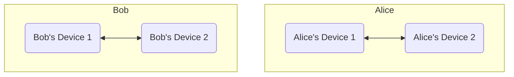
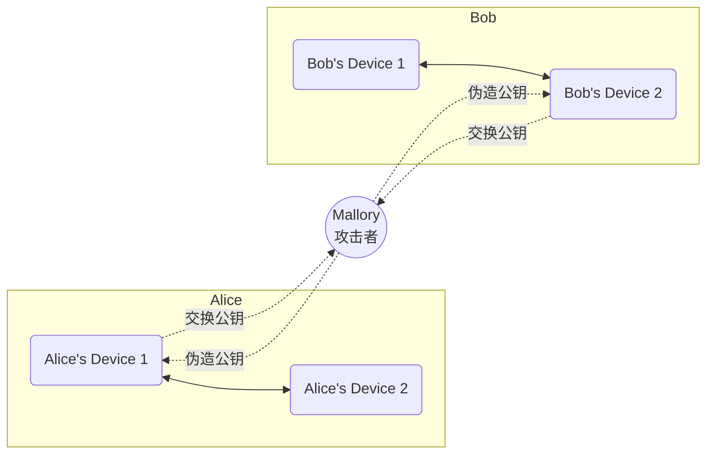
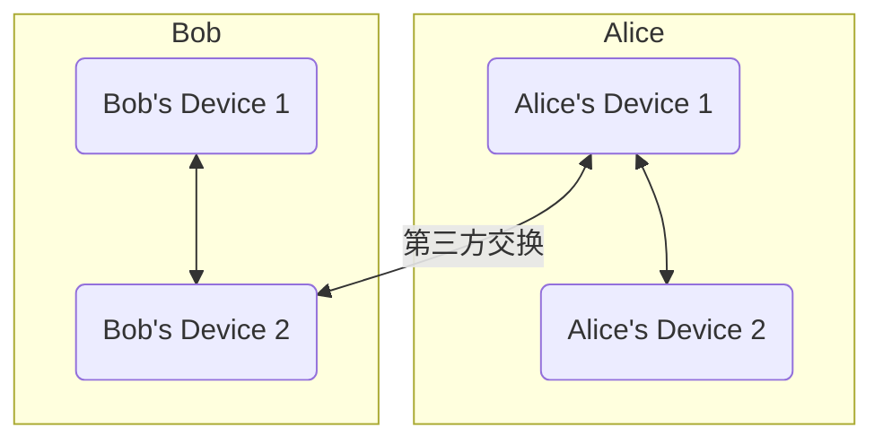
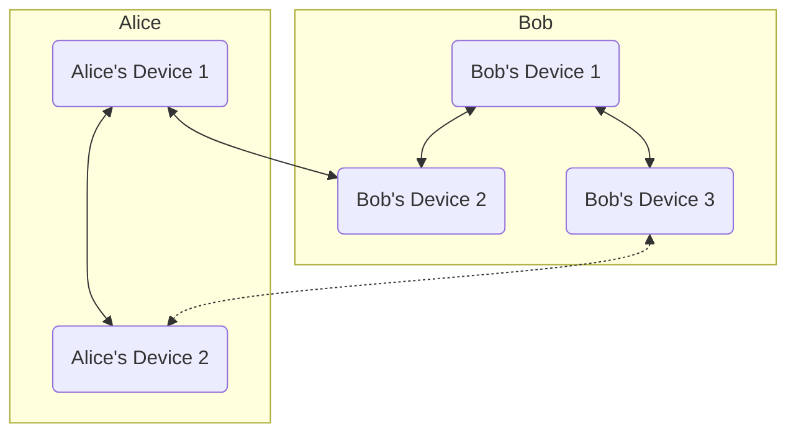

# 设备密钥与交叉认证

如果您对非对称加密有所耳闻，那么一定知道它难以抵抗“中间人攻击”，Matrix 同样暴露在这种威胁之下。在 TLS 中，抵御中间人攻击靠的是权威第三方进行“公钥签名”，但在 Matrix 协议里显然不能这么做——Matrix 的信任模型要求您永远不要把服务器当作可信的。一旦服务器对您的客户端发起中间人攻击，就能轻易插手您和对方的加密聊天，拿到全部数据。

要确认对方发来的公钥确实来自对方本人、而不是中间人，就需要一个额外且不受中间人控制的渠道来比对密钥，比如 QQ / 微信聊天（这条渠道本身是否安全并不重要，只要不受 Matrix 系统管理员控制即可）。在 Matrix 中，你们可以在这类渠道里比对双方生成的 Emoji 图案顺序来完成确认：顺序一致，就说明双方都是可信的，两台设备便会互相为对方的密钥签名，承认其合法性。

## Matrix对中间人攻击的防御

每个 Matrix 客户端都持有且仅持有一个设备密钥。密钥一旦丢失或被重置，Matrix 就会认为该用户正在使用新设备。
当用户的新设备登录 Matrix 时，会被要求用已有设备为新设备的密钥签名。这样做是为了防范两种潜在威胁：

1. 账号密码泄露，被其他人假冒登录，或者被服务器管理员（已知您的密码）登录。
2. 服务器尝试对已有的设备进行中间人攻击，用服务器的中间人公钥替换你们交换给对方的公钥，尝试破解你们的消息。

如果您拒绝签名，或者确实遭到了第三方攻击，Element 会显示一个醒目的红色感叹号图标，表示该设备的密钥不受信任，可能是中间人攻击。

所谓设备签名认证，就是用您已有的设备密钥去签名新设备的密钥，让新设备快速获得您其他设备的信任。这种信任会随交叉认证传递给已经信任您其中一台设备的其他用户的设备——不需要额外的认证流程，您就能快速、安全地用新设备和别人聊天，而在别人看来，您的新设备已经是“已认证”状态，和手动认证过的老设备没有区别。下面讲述这套认证的具体原理。

## 交叉认证原理

我们假设，网络中有AB两个用户，他们各自独立拥有两台设备，每个人的两台设备都是互相信任的设备，但两个用户之间没有建立其他的认证关系。

现在，Alice使用“Alice's Device 1”向Bob的“Bob's Device 2”聊天，两人交换了对应设备的公钥。但由于两人并没有进行任何的认证，因此双方都无法充分的信任对方发来的公钥。

此时，在Alice和Bob的设备上看去，对方的加密图案是灰色的，意为该聊天可能不受信任。这个灰色的图案是Matrix服务器提供的保证，Matrix服务器告诉双方，双方的设备都经过各自独立的签名，不过因为这只是服务器的一面之词，你还没有验证这一点，所以Element非常保守的选择了灰色的图标。如果有用户的设备还没有经过其他设备的签名，Matrix服务器会警告客户端，Element则会显示一个红色的感叹号图标。

无论是灰色还是红色，都不是好的颜色，因此Alice向Bob提出进行[密钥交换](cryptology#%E8%BF%AA%E8%8F%B2-%E8%B5%AB%E5%B0%94%E6%9B%BC%E5%AF%86%E9%92%A5%E4%BA%A4%E6%8D%A2)，以确认对方发来的公钥和对方设备公钥是一致的。密钥交换实际发生在一个不受Matrix系统控制的第三方环境中，比如QQ微信，或者其他Matrix服务器（比如官方服务器）。

他们经过交换，确认对方发来的公钥就是他们自己的公钥，因此彻底证实了对方设备的安全性，因此双方的设备之一就互相信任了。

两个设备之间的信任关系，可以传递到对方的所有设备中，因此Bob's Device 2和Alice's Device 2进行通信的时候，也可以直接通过Bob's Device 2和Alice's Device 1建立的信任关系而间接互相信任，从此Alice和Bob就不再需要进行第三方密钥交换，可以自然信任所有对方的新设备和旧设备了。

未来，Bob添加了新设备Bob's Device 3，并与Bob's Device 1互相信任，此时Bob's Device 3和Alice's Device 2的聊天也可以通过Bob's Device 2和Alice's Device 1建立的信任关系而间接互相信任。

以下示意图说明了这一点，图中实线部分是已经确定建立的信任关系，虚线部分表达了Bob's Device 3和Alice's Device 2建立的对话可以直接通过实线部分的信任链信任。这就是交叉信任的原理和目的。

## 交叉认证方法

要认证某个人的设备，您至少需要拥有自己的 Megolm 密钥库，因此要先用安全密钥验证自己的设备，方法请参考[导入安全密钥](secure-key#加载安全密钥)。验证某个用户时，请确保自己和对方之间除了 NerChat! 之外还有第二个通信渠道——电子邮件、其他社交平台，或者一条稳定的视频通话都行，最推荐的还是线下见面。这个渠道用来分享各自的 emoji 图案，并与对方比对是否一致。

::: tabs

== Web

在与要验证的用户的聊天中点击对方头像，可以看到他的所有设备及其验证状态：绿色为已验证设备；灰色表示没有经过您的验证，但通过了其他人的验证；红色则表示没有经过任何人验证，不可信任。

- 您可以点击聊天室的“验证”按钮，申请进行迪菲-赫尔曼密钥交换，并基于此次交换的结果重新开始双棘轮加密过程，您之前的密钥依然会保存在密码库中，作为解密历史消息的手段。

    1. 点击聊天信息按钮，在菜单里点击“验证”。

        

    2. 点击“开始验证”开始两个人的验证过程。您此时最好已经做好和对方用另一种方式聊天的准备。

        
        

        您可以“接受”弹出的“已请求验证”通知，也可以点击聊天记录里出现的“想要验证”消息的“接受“按钮来接受验证，两种方法是一样的。

    3. 两人中的任何一方都可以主动点击“通过表情符号验证”按钮发起验证。

        

    4. 通过可靠渠道比对二人生成的emoji表情序列，看看他们是否相同。如果相同，则说明会话安全，没有中间人，验证通过，可以用这个临时建立的可信加密通道交换公钥了。如果不同……放心不可能不同的。NerChat!绝对安全，同时我们对您的加密聊天内容完全不感兴趣，不会进行中间人攻击，您永远可以信任我们的服务器。

        

    5. 两人均点击“他们匹配”之后，整个验证流程就结束了。

    验证结束之后，一个可靠的加密通道就顺利建立起来了。两人会用这个通道建立一个临时的连接，交换公钥互相签名认证对方的身份，以后的聊天就可以通过这个可信的密钥进行了。

- 您还可以点击灰色或红色的设备，然后在窗口中选择“文本”或者“emoji”以开始验证对方的某个设备，验证流程如下。

    1. 点击聊天信息按钮，在菜单里点击对方的头像，在对方的信息页面里点击“x个会话”，展开设备列表。选择一个灰色或红色的设备来开始验证。

        <!--markdownlint-disable MD033 -->
        

          
          
        

        <!--markdownlint-enable MD033 -->

    2. 在弹出的对话中选择“以文本形式验证”或“以emoji形式验证”二者的原理相同，不过比起emoji，文本在互联网上的传输更加容易一些。

== Mobile

在移动端，您可以验证一个加密聊天的安全性，方法和Web端相似。

1. 在聊天列表中，打开与一个人的聊天对话窗口，点击顶部头像栏，打开聊天信息窗口。

    

2. 下拉菜单，找到“2人”选项，点击查看房间的全部成员。

    

3. 在成员中点击你想要验证的人，打开他的个人信息详情页面。

    <!--markdownlint-disable MD033-->
    

        
        
    

    <!--markdownlint-enable MD033-->

4. 点击“验证”按钮，开始你们之间的验证流程。

    

    此时，另一个人会在聊天栏里看到验证请求，同时还会收到消息推送。

    

    另一个人点击“接受”。

5. 选择一种验证方式，这里选择emoji方法。当然您也可以点击二维码验证方法，去拍摄另一人设备上出现的二维码。

    

    点击emoji方法之后，会弹出一些emoji图标，请在一个受信任的环境中和对方比对你们设备上的emoji符号是否一致。

    <!--markdownlint-disable MD033-->
    

        
        
    

    <!--markdownlint-enable MD033-->

6. 如果emoji序列相同，则说明会话安全，没有中间人，验证通过，可以用这个临时建立的可信加密通道交换公钥了。如果不同……放心不可能不同的。NerChat!绝对安全，同时我们对您的加密聊天内容完全不感兴趣，不会进行中间人攻击，您永远可以信任我们的服务器。

    当emoji验证完成之后，点击“匹配”，完成验证过程。

    

7. 验证完成之后，您可以看到对方的设备图标已经变成了绿色的盾牌，说明对方的现在的设备公钥包含了您自己的签名，是完全可以信任的。现在，一个可靠的加密聊天通道已经建立，你们可以进行完全可信的安全加密聊天过程了。

    <!--markdownlint-disable MD033-->
    

        
        
    

    <!--markdownlint-enable MD033-->

:::

设备认证的过程确实复杂，但这是非对称加密固有的代价。设备验证能够彻底保证：只有与您聊天的对方本人，才能看到您的消息并给您发送消息，从而保证聊天的安全性。
如果您追求极致安全，可以检查一个聊天室中是否所有用户都持有绿色盾牌。如果是，那么这个聊天的过程完全可信，服务器没有从中做手脚的可能。有关这一问题的详细讨论，请参考[威胁模型](device-and-secret#威胁模型)。

可以说，这套公钥认证体系在服务器上建立起了一套可信的 CA 体系，让您能以最少的验证次数覆盖最多的用户设备。

::: danger

不要轻易重置自己的密钥。一旦密钥重置，所有包含您在内的信任链将会被摧毁，很多用户不得不重新开始验证过程才能互相确认彼此聊天的安全。

:::

## 否认交叉签名的有效性

如果您从未认证过自己不信任的设备，并且相信您所认证设备的持有者也不会这么做，那么绿色盾牌就是可靠的——但如果您不放心呢？当然可以选择不信任：关闭对交叉验证的信任后，您只信任自己亲自验证过的密钥和设备，其他设备都需要手动逐个确认。

::: tabs

== Web

点击头像->所有设置->隐私安全->高级 加密 “手动验证所有远程会话”

== Mobile

移动端暂时没有实现该功能。

:::
