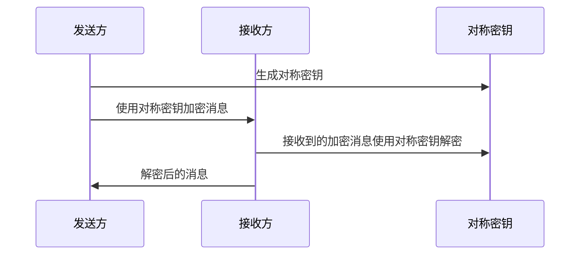
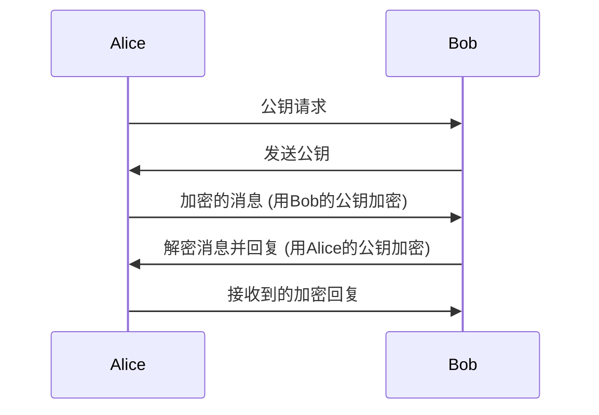
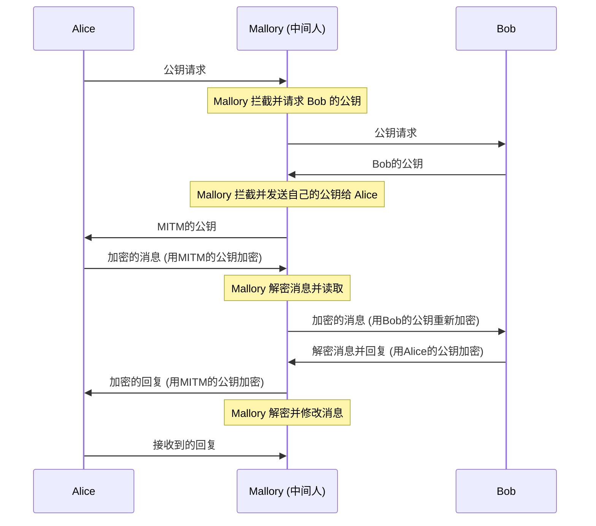
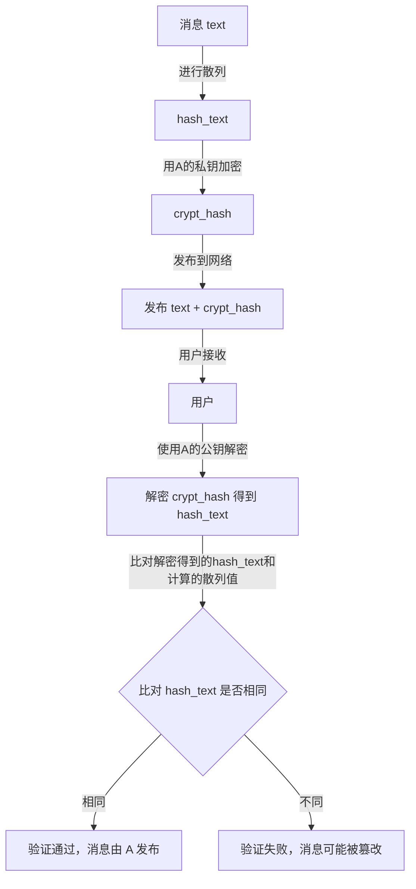
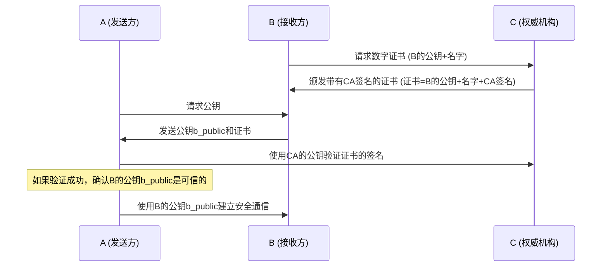
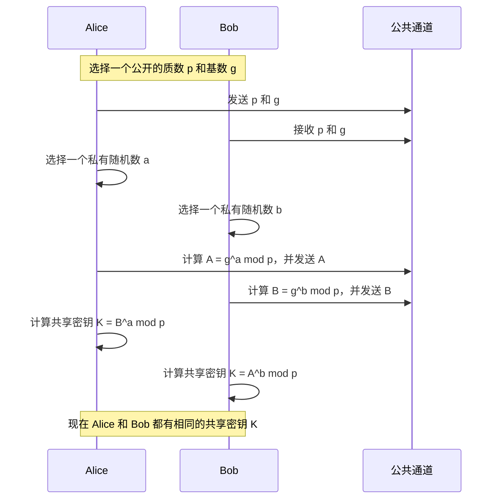

# 密码学综述

Matrix 是一个严格加密的协议。本章会大致介绍 Matrix 加密协议背后的密码学知识，希望这些内容能帮助读者更好地理解 Matrix / Element 的加密实现。

::: info

本文不是必看内容，但会尽量写得浅显易懂。推荐 NerChat! 的用户对密码学有一点基础了解；如果您已经精通密码学，就不必再看这篇错漏难免的文章了。

本文的目标是让完全不了解密码学的新手快速过一遍，因此写得非常简略。

:::

## 对称加密

对称加密是最基础的算法：用同一个密钥把消息变成密文，解密时再用它还原。

对称加密的成本低，安全性也相对低，密钥的作用至关重要。在 Matrix 中，对称加密主要用于加密 Megolm 密钥库，再上传到服务器备份。

如果这把密钥被攻击者轻易拿到，他就能随意解密消息，非常不安全。

## 非对称加密

非对称加密把加密和解密分开：通信双方各自生成一对公钥和私钥，公钥公开发布，私钥自己保留。
B 可以用 A 的公钥加密消息并发给 A，A 收到后用自己的私钥解密，就能读到 B 写的明文。
网络上的攻击者只能拿到公钥和密文，无法解密消息本身——这是一种很聪明的设计。

但非对称加密会受到中间人攻击的威胁，这是一个很重要的问题，下面详细说明。

## 中间人攻击

中间人攻击专门针对没有公钥认证体系的非对称加密：网络中的攻击者充当中间人，同时生成两对公私钥，一对用于和 Alice 通信，一对用于和 Bob 通信。如果 Alice 和 Bob 对彼此发来的公钥不作任何确认就默认信任，攻击就成立了——中间人能看到全部加密内容，也能随意篡改后再发给对端。

## 散列与签名

散列（hash）是一种摘要算法：通过特定的运算，让每条消息几乎唯一地对应一串字符，不同消息对应不同序列，相同消息对应相同序列。

在非对称加密中，A 用自己的私钥加密一段消息后，任何人都可以用 A 发布的公钥解开。
如果 A 发送消息 text，先对 text 做散列得到 hash_text，再用自己的私钥加密 hash_text 得到 crypt_hash，然后把 text + crypt_hash 一起发布，
知道 A 公钥的用户就可以用 A 的公钥解开 crypt_hash 得到 hash_text，再比对它是否真的等于 text 的散列值；如果相同，就说明这份 text 确实出自 A，
因为只有 A 握有加密 hash_text 所需的私钥。

这个 crypt_hash 就称为 text 的签名，它意味着您可以完全相信这条消息的作者是 A。

## 证书、CA

既然中间人可能介入非对称加密的过程、让通信不再安全，我们迫切需要一种可靠的方法来确认公钥确实来自可信的来源。数字证书由此而来。

A 想和不安全网络中的 B 通信。B 为了让 A 相信自己，找到权威机构 C，请 C 为自己的一些信息（B 的公钥 b_public 和 B 的名字 b_name）签名。A 向 B 请求公钥时，B 不仅发来自己的公钥，还附带 C 的签名。由于 A 相信 C 的私钥不会泄露，并且知道 B 的名字是 b_name，A 就可以用 C 公开发布的公钥验证这个签名，确认公钥确实属于 B，然后放心地与 B 建立加密通信。

我们把（B 的公钥 b_public + B 的名字 b_name）称为 C“颁发”给 B 的“证书”，权威机构 C 则被称为“CA”。

## 交叉认证

交叉认证是一种用信任链简化互相认证过程的技术，详见[交叉认证](cross-sign)一章。

## 迪菲-赫尔曼密钥交换

迪菲-赫尔曼密钥交换（Diffie–Hellman，D-H）是一种安全协议：双方在互不掌握对方任何预先信息的情况下，通过一条不安全的信道协商出一个密钥，并在后续通信中把它当作对称密钥使用。只需在公共信道上交换一次信息，双方便能获得一个可以安全通信的共享秘密。

举个例子：A 和 B 想在 NerChat! 中建立一条安全的通信渠道，于是进行一次迪菲-赫尔曼密钥交换，再在 QQ 上比对交换结果——具体表现为一串 emoji 表情。如果两边的序列完全一致，就说明双方的密钥是安全的，没有被中间人篡改。

## 双棘轮加密

棘轮加密可以想象成一只只能向前走的秒针：后面的密钥很容易从前面的密钥算出，而前面的密钥几乎不可能从后面的密钥倒推回来。这类加密用于保护群聊消息，是即时通信领域最新的密码学应用。

双棘轮算法（Double Ratchet Algorithm）是一套相当复杂的加密系统，广泛用于现代即时通信的消息加密。即使某一时刻的密钥泄露，它仍能保护更早或更晚的消息记录。它的根密钥建立在迪菲-赫尔曼密钥交换之上，在 Matrix 中的体现就是：经过交叉验证的群聊，其加密完全可信。

更多内容可以参考网上的相关资料。

- [知乎专栏-对称加密与非对称加密](https://zhuanlan.zhihu.com/p/436455172)
- [思否-SSL/TLS](https://segmentfault.com/a/1190000002554673)
