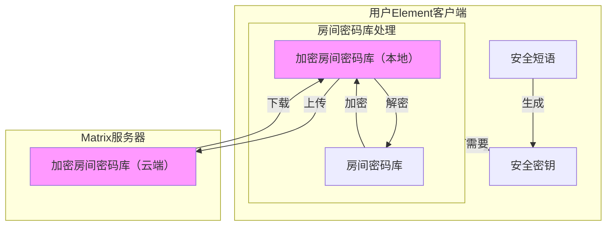

# 安全密钥

::: warning

**注意：本章内容非常重要，每一位 NerChat! 用户都应掌握。**

:::

::: warning

不要把登录密码和加密密钥混为一谈：登录密码只是限制登录的一道屏障，管理员可以轻易获得；而只要您的安全密钥足够强，管理员永远无法取得您已经广为信任的加密密钥。所以请务必用强密码保护您的密钥库。

:::

## 房间密钥库与安全密钥

在 Matrix 中，用户加入的每个房间都会在本地保存一个密钥，这是加密聊天的基础。此外 Matrix 还要保存大量其他用户密钥信息，它们共同保证您能在各个加密房间中正常聊天。一旦换了新设备、又没有把原密钥一起带过来，之前的聊天记录就无法解密，会非常麻烦。因此，为了在保证安全的前提下提升易用性，Matrix 服务器支持用户把密钥库、设备密钥等信息在本地加密后上传托管：需要取用时，Element 客户端会从服务器下载密钥库，您只要提供正确的 **安全密钥** 或 **安全短语**，就能取回密钥库的全部内容，进而解密服务器上的数据、还原完整的房间历史。也就是说，即使客户端数据全部丢失，仅凭正确的 **安全密钥** 或 **安全短语** 也能完整恢复聊天内容。在 Element 客户端中，**安全密钥** 表现为 12 组 4 字符的组合，既可由 **安全短语** 计算得到，也可以随机生成。

**安全密钥** 就是您在 Matrix 世界里的“钥匙”和“身份证”，重要性不言而喻。因此用户首次登录后，我们 **强烈建议** 立即导出安全密钥并妥善保管，方便日后使用。安全密钥本身强度较高，拿到它就等于掌握了整个房间密钥库。下面的示意图供参考：

::: danger

保护您的安全密钥**非常重要**！

安全密钥一旦丢失，您将彻底失去自己的加密群组消息。

安全密钥一旦泄露，掌握服务器数据的人就能读取您所在加密群组中**所有**您能看到的消息。

:::

您也可以选择直接导出整个房间密钥库：虽然麻烦一些，但在各设备之间离线同步比较方便，也不必从服务器下载庞大的密钥库。当新设备一时无法解密房间历史消息时，这种方法可以加速解密，详情可参考[加密协议](protocol)。

## 生成并导出安全密钥

首次登录后请尽快导出密钥，以便在新设备上加载、继续使用之前的加密会话。具体操作如下：

::: tabs

== Web

1. 点击头像，打开设置选项。

    

2. 在打开的设置界面中，选择“隐私安全”，然后在右侧的“安全备份”下点击“设置”按钮。

    

3. 弹出的菜单会询问您要如何保存密钥。
    - 如果选择“生成一个安全密钥”，客户端会直接给您生成一个密钥文件供您使用。
    - 如果选择“使用一个安全密码”，客户端会基于您提供的密码来生成这个密钥文件。

    两种方法都可以，没有孰优孰劣之分。使用密码导出密钥更加方便，但直接生成密钥则更加安全。理论上来说，两种方法都可以有效的保护您的加密消息。
    因此 NerChat! 更推荐用一个自己记得住、长度足够的密码来保存密钥，这个密码称为==安全短语==。

    

4. 在弹出的菜单里选择下载密钥或复制密钥到一个空文件中，把生成的密钥保存起来，然后点击继续，完成整个流程。

== Mobile

1. 在移动端注册并首次登录后，点击用户头像打开设置。

    <!--markdownlint-disable MD033-->
    

    
    
    
    

    <!--markdownlint-enable MD033-->

2. 在设置中找到“安全与隐私”，点击。

3. 找到“安全备份”选项组，点击“在此设备上设置”。

    

4. 如果你确实是首次在此设备上登录，那么“安全备份”会直接弹出。弹出的菜单会询问您要如何保存密钥。
    - 如果选择“生成一个安全密钥”，客户端会直接给您生成一个密钥文件供您使用。
    - 如果选择“使用一个安全密码”，客户端会基于您提供的密码来生成这个密钥文件。

    两种方法都可以，没有孰优孰劣之分。使用密码导出密钥更加方便，但直接生成密钥则更加安全。理论上来说，两种方法都可以有效的保护您的加密消息。
    因此 NerChat! 更推荐用一个自己记得住、长度足够的密码来保存密钥：这样在设备间切换时不必反复验证，直接输入密码即可。

5. 当你完成保存之后，会出现一个“继续”按钮。点击此按钮结束密钥备份操作。

:::

这样密钥就成功导出到本地文件了，请妥善保管！

## 加载安全密钥

在新设备上登录后，客户端会向服务器请求并下载加密的密钥库，此时需要您提供正确的安全密钥或安全短语来解密，才能正常显示聊天记录。

::: tabs

== Web

1. 在全新的浏览器上登录一个已注册并导出过安全密钥的账号时，输入账号密码并点击登录后，系统会要求您提供安全密钥。

    

    如果你还有其他设备可以登录账号，也可以**使用其他设备进行验证**，就不需要手动输入安全短语或者选择密钥文件了。

    

2. 点击“使用安全密钥或短语来验证”，输入您首次登录时设置的==安全短语==。

    

    或者，如果您一开始设置的是安全密钥，可以点击“使用安全密钥”切换到输入安全密钥的模式，然后上传之前导出的安全密钥文件，或者将文件的内容（4*12个字符）直接拷贝到左侧的输入框中。

    

    当然，如果你丢失了密钥，也不再想要保留自己过去的聊天记录了，可以直接就地重置自己的密钥。重置密钥后，你需要重新导出自己的加密密钥。

    

    重置密钥后，您其他正常登录的设备会收到警告，提示有设备重置了密钥，并提醒可能存在盗号风险。如果在没有任何密钥备份的情况下重置密钥，您将永远无法再取回之前的聊天记录。

    

    如果点击“X”关闭对话框，客户端会提示跳过验证的后果：无法访问历史消息，设备也不会被其他人信任。如果现在不方便输入密钥，可以点击“我将稍后进行验证”，您仍能正常进入系统聊天，但系统会提醒您尽快完成验证。

3. 输入正确的==安全短语==（或提供正确的安全密钥）后，客户端会自动验证成功，此时您就能访问之前所有的加密消息了。

    ::: info

    如果你备份了房间密码库，那么你大可直接跳过这个提供安全密钥的环节，而换成直接导入房间密码库。
    但是注意房间密码库在设备之间交换非常困难，需要频繁的导入导出，相当不方便，因此并不推荐使用这种方法。

    :::

    ::: info

    如果你没有提供安全密钥，那么您将不能访问您的加密消息。在Web端，具体表现为无法阅读之前自己发送和收到的加密消息，如图所示。

    

    如果你提供了密钥但依然遇到了这个问题，请稍等片刻再检查。如果等待了很长时间依然不能解密消息，请参阅[帮助](../help/faq#我不能解密聊天记录)部分。

    :::

== Mobile

当您在移动端设备登录后，如果之前您已经导出了密钥，那么顶部会出现提示“验证此设备”。当您点击之后，它会要求您“使用恢复口令或密钥”，如果您还有其他登录着NerChat!账号的客户端，您还可以通过这些已经登录了账号的客户端来认证这个新设备，如第二张图所示的那样。

<!--markdownlint-disable MD033-->

  
  
  

<!--markdownlint-enable MD033-->

- 如果您身边有已认证的设备、又不想输入安全密钥，可以用那台设备来认证当前会话——密钥会经过非对称加密后，经由 NerChat! 从一台设备分享给另一台设备。具体步骤如下：

    1. 此时您已经登录的设备会弹出提示，询问您是否同意此设备的验证请求。里面会提供这个设备客户端的名称、ip地址。您点击“接受”，尝试开始与客户端的认证。

        

    2. 弹出的窗口中会询问你想使用何种方式验证——扫描二维码或者使用表情符号。如果您手机有摄像头，推荐使用二维码的方法验证。如果您不方便使用二维码验证，可以用表情符号，遵照提示进行验证就可以。

    3. 完成验证后，双方互相确认，就可以完成整个过程了。

        
        

- 如果暂时没有可用来认证的设备，也可以输入安全短语或提供安全密钥来完成验证。具体步骤如下：

    1. 点击“使用恢复口令词组或密钥”按钮，在弹出的对话框中输入自己的==安全短语==。或者如果您没有使用安全短语来保存密钥，您可以上传自己的安全密钥，或粘贴其中的内容。两种模式的切换可以通过点击“使用恢复密钥”和返回键来实现。

        <!--markdownlint-disable MD033-->
        

            
            
        

        <!--markdownlint-ensable MD033-->

    2. 客户端会开始计算密码，如果密码正确，那么客户端会提示“认证成功”。点击“完成”结束验证过程。

        <!--markdownlint-disable MD033-->
        

            
            
        

        <!--markdownlint-enable MD033-->

    ::: info

    如果你备份了房间密码库，那么你大可直接跳过这个提供安全密钥的环节，而换成直接导入房间密码库。
    但是注意房间密码库在设备之间交换非常困难，需要频繁的导入导出，相当不方便，因此并不推荐使用这种方法。

    :::

    ::: info

    如果你没有提供安全密钥，那么您将不能访问您的加密消息。在移动端，具体表现为无法阅读之前自己发送和收到的加密消息，如图所示。

    

    如果你提供了密钥但依然遇到了这个问题，请稍等片刻再检查。如果等待了很长时间依然不能解密消息，请参阅[帮助](../help/faq)部分。

    :::

:::

需要注意的是，输入安全密钥后并不会立刻获得全部加密聊天记录：需要等服务器把聊天记录和加密密钥发送完毕才能全部解密，耗时取决于您和服务器的网络环境，一般不会超过 1 分钟。如果您不是通过输入安全密钥、而是通过其他设备完成认证，则可能无法解码部分历史聊天记录。这时可以尝试恢复历史密钥；如果您之前导出过加密房间的密钥库，也可以从旧的备份中恢复。具体操作详见[密钥备份与恢复](local-backup)。
